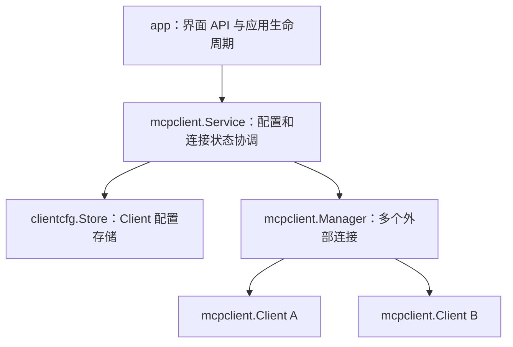

# MCP Client 配置与连接管理

Client 后端暂时保留，尚未接入 Agent 或客户端设置界面；未来开展 Client 功能前，需要重新 review。当前不增加 Client 功能或单小说级别配置。

## 各部分职责

| 部分 | 负责内容 |
| --- | --- |
| `app` | Wails API、错误适配和 Service 初始化、关闭；不编排连接配置。 |
| `mcpclient.Service` | 协调配置存储和 Manager；连接配置 CRUD、凭据输入、权限修改、工具查询与刷新。先保存配置，成功后发布给 Manager。 |
| `mcpclient/clientcfg` | 配置结构、全部静态校验及加密 Store。Load / Save 补齐凭据 map 并调用 State.Validate，不管理网络连接。 |
| `mcpclient.Manager` | 按稳定 ID 管理多个外部连接，负责按需连接、工具缓存、权限检查和连接清理。 |
| `mcpclient.Client` | 单个 MCP 会话的协议封装：连接、工具发现、工具调用和关闭。 |

Manager 管理顶层 context，并为各连接派生 context。更新连接配置会取消并清理旧连接；工具授权更新保留工具缓存，并撤销旧连接及其在途请求。连接操作在 Manager 中执行，网络刷新不持有 Service 的配置锁。Service 关闭时关闭 Manager；本地 MCP Server 的配置和生命周期由另一方向独立管理。

## 配置结构与校验

`TransportSettings` 只包含 Transport、Command、Args、Endpoint，供持久化设置与 Client 运行参数匿名嵌入。其 `Validate(env)` 检查建立连接所需的参数，不检查连接 ID、名称或凭据存储策略。

`ConnectionSettings` 在传输设置上增加 ID、Name、Enabled。持久化 Connection 和 ConnectionInput 匿名嵌入这份设置，分别增加工具授权和凭据输入；这些嵌入都在 Client 方向内部，JSON 字段保持平铺。

`Connection.Validate(secrets)` 复用传输校验，再检查 ID、名称、Bearer Token、stdio 不允许 HTTP Token，以及持久化 URL 不允许 userinfo、query、fragment 的约束。直接调用 Client 的运行参数不受这些 URL 存储约束影响。`State.Validate()` 汇总连接校验并检查 ID 唯一性；Load 成功返回的结果已经通过配置包的全部校验。

Client 的 Config 在传输设置上增加 Env 和 HTTPClient。Env 从持久化的 Secrets 取得，HTTPClient 由 Manager 构造用于认证和重定向控制，不保存到磁盘。

## 输入与查询 DTO

ConnectionInput 的 Credentials 为 nil 时保留原凭据，非 nil 时整体替换，空对象用于清除。输入不接收工具授权，授权由专门接口修改。

ConnectionView.config 复用 clientcfg.Connection，额外提供 EnvKeys、HasBearerToken 和实际连接状态。查询复制配置中的 map、slice，并只返回环境变量名和令牌存在状态，避免泄露凭据或让调用方改写内部配置。

## 存储与异常

全局配置保存在 `~/.goink/mcp_client_config.enc`，快照包含 connections 和 credentials。连接使用稳定 ID，名称变化不影响 ID。Server 使用另一个配置文件，两个 Store 不向同一文件写入各自快照。

沿用 LLM 的 AES-256-GCM 固定密钥与现有加密格式，通过同目录临时文件、同步、关闭和重命名写入，文件权限为 0600。当前格式尚未发行，不提供旧 MCP 格式迁移，也不实现通用 mcpServers 导入导出。

读取、解密或校验失败时保留原文件，构造函数仍返回停用的 Service 和错误；不配置 Manager，并拒绝后续配置写入。修复文件后重启应用重新加载。配置保存失败不会发布新的连接或授权，小说编辑等核心功能继续初始化。
