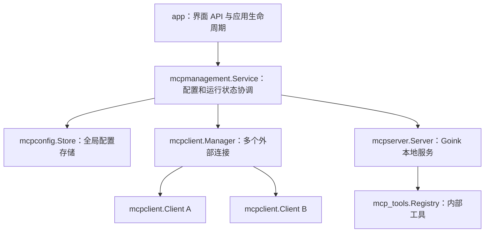

# MCP 配置与运行管理

当前以 Goink 本地 MCP Server 为交付范围。Client 后端代码暂时保留，尚未接入 Agent 或客户端设置界面；未来开展 Client 功能前，需要重新 review。当前不提供远程 Server 部署，也没有单小说级别的 MCP 配置。

## 各部分职责

| 部分 | 负责内容 |
| --- | --- |
| `app` | Wails API、DTO 和错误适配；在应用初始化与退出时接入管理服务。 |
| `mcpmanagement.Service` | 协调配置存储、外部连接和本地 Server；管理启停、权限、令牌生成、轮换及撤销。 |
| `mcpconfig.Store` | 读取和原子写入全局配置，复用应用加密实现；不管理网络连接。 |
| `mcpclient.Manager` | 按稳定 ID 管理多个外部连接，负责按需连接、工具缓存、权限检查和连接清理。 |
| `mcpclient.Client` | 单个 MCP 会话的协议封装：连接、工具发现、工具调用和关闭。 |
| `mcpserver.Server` | 本地监听、Token 鉴权、工具白名单、当前小说上下文和在途调用管理。 |
| `mcp_tools.Registry` | 注册内部领域工具，供本地调用和 MCP Server 选用。 |

Client Manager 管理多个外部连接，顶层 context 下派生各连接 context。Goink 当前只有一个本地 Server 实例，其运行生命周期由 `Server` 自己管理，无需再增加 Server Manager。两方向可以分别启停，应用退出时由 Service 统一关闭。

`mcpconfig` 定义共用的 Transport 类型以及全部静态配置规则，包括连接 ID、名称、ID 唯一性、传输参数、环境变量、URL、凭据格式、本地端口，以及启用状态与 Token 的一致性。Store 加载、保存时补齐默认端口与凭据 map，内部调用 `State.Validate()`；`Load()` 成功返回的结果已经通过配置包的全部校验。无效快照不会写入磁盘；加载失败保留原文件。Client 复用配置包的传输参数校验，不重新声明规则。Service 只检查当前工具开放策略并编排配置与运行状态；Server 检查工具是否实际注册以及是否完全停止，负责执行运行操作。

App 统一通过管理服务关闭 MCP；管理服务尚未创建时才直接关闭 Server，避免正常退出重复关闭同一实例。

## 查询 DTO

`ConnectionView.config` 复用 `mcpconfig.Connection`，额外字段只包含凭据摘要和实际连接状态。返回时复制配置中的 map、slice，避免调用方改写内部配置。

`mcpconfig.ConnectionSettings` 定义 ID、名称、传输方式、命令、参数、地址和启用状态。持久化 `Connection` 与 `ConnectionInput` 匿名嵌入这份设置，各自增加工具授权和凭据输入。匿名嵌入保持现有配置 JSON 字段平铺，输入不会接收工具授权字段，工具授权仍由专门接口修改。

`LocalView.config` 复用 `mcpconfig.Local`，其余字段只提供可开放工具、Token、运行状态和错误。凭据是否存在由 `token` 是否为空判断，不重复返回 `has_credential`。

本地设置查询、保存和轮换均直接返回 `LocalView`，Token 只出现在其 `token` 字段，不再额外包装重复的 Token。当前接口尚未发行，同步生成绑定和调用方，不保留旧 DTO 兼容层。

## 存储

配置保存在 `~/.goink/mcp_config.enc`，包含外部连接、凭据、本地 Server 开关、端口、工具权限和 Token。连接使用稳定 ID，显示名称变化不影响 ID。内部保存完整配置快照，当前不实现通用 `mcpServers` 导入导出。

配置与 LLM 共用原有 AES-256-GCM 密钥。写入通过同目录临时文件、同步、关闭和重命名完成，配置文件权限为 `0600`。当前格式尚未发行，不提供旧 MCP 格式迁移。

## 配置异常与核心应用启动

读取、解密或配置校验失败只停用 MCP，不阻止小说编辑等核心功能初始化。Service 构造失败时仍返回一个停用的管理实例和加载错误；调用方保留该实例供设置查询和统一关闭使用。

异常文件原样保留，不自动覆盖或恢复为默认文件。设置查询返回加载错误；配置恢复前拒绝写入和启动 MCP，避免用空状态覆盖原配置。修复配置文件后重新启动应用即可重新加载，当前不增加配置重置或迁移机制。

## Token

Service 在首次启用且没有 Token 时生成并保存 Token，然后交给 Server 鉴权。普通启停和应用重启沿用已保存的 Token；主动轮换生成新 Token，撤销则清除 Token 并关闭服务。

这是本地桌面管理接口，不采用一次性展示策略。Server 设置查询与设置保存结果均返回当前已保存的 Token，包括配置保存成功但后续启停失败的情况。前端即使因 Wails 错误返回而丢弃操作结果，也可重新查询设置获得 Token。落盘失败时不返回未保存的新 Token。

外部连接的环境变量和 Bearer Token 仍不通过普通列表返回；本次可重复读取的凭据仅指 Goink 自己的 Server Token。

## 地址与端口

Goink 仅监听 `127.0.0.1`，默认端口为 `5108`，端点为 `http://127.0.0.1:5108/mcp`。允许保存自定义端口，合法范围为 `1..65535`；配置未指定端口时使用默认值，保存设置未指定端口时沿用当前值。

重启、修改工具权限和轮换 Token 均沿用配置中的端口。端口被占用时返回启动错误，不回退到随机端口，避免客户端地址悄悄改变。底层 Server 允许测试显式使用端口 `0`，应用管理层不会将 `0` 用作实际监听端口。

## 验证

- 异常配置下核心应用继续可用，MCP 停用、错误可查询，原文件不被覆盖。
- Token 可重复查询；首次启用和轮换在启停失败后仍可恢复凭据。
- 重启和轮换不改变端口；端口冲突明确报错，释放端口后可重试。
- 运行相关 Go 测试、竞态检查和应用构建，并通过 Wails 生成器更新绑定。
